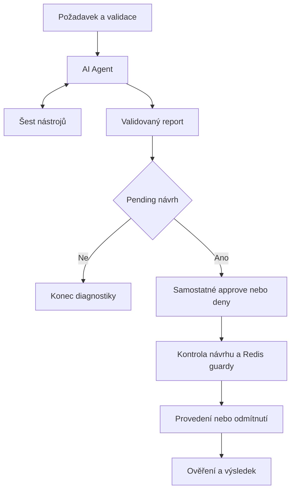

# FABINI — AI Operations Agent

**Verze balíčku: v2.2 final — ověřená sync evidence, přísná validace reportu a testy schvalovacího workflow.** Podrobnosti: [docs/CHANGELOG.md](docs/CHANGELOG.md).

Funkční prototyp provozního AI agenta pro diagnostiku objednávek. Agent přijímá požadavek v přirozeném jazyce, sám vybírá nástroje a podle jejich výsledků pokračuje v šetření. Změny v simulovaných systémech provádí až po samostatném schválení člověkem.

**Technologie:** n8n 2.21.7, n8n AI Agent / LangChain tool calling, OpenRouter (`google/gemini-2.5-flash`), JavaScript v Code nodes, Redis pro atomické omezení akcí. Python slouží pouze jako volitelný klient a pro kontrolu exportů.

Nejde o produkční nasazení. Všechna obchodní data jsou testovací; žádné skutečné platby, objednávky ani e-maily FABINI se nemění.

**Ověření v2.2:** 73/73 offline regresních kontrol, mock testy a 3/3 Python testy. Finální podoba v2.2 byla navíc **ověřena živě** 15. 10. 2026 na n8n 2.21.7 (execution mode `regular`) s reálným Redis a LLM: diagnostika → approve → ověření, blokace opakovaného schválení (409), denial a souběžná schválení dvou návrhů stejné akce (200 a 429 podle čítače Redis). Přehled je v [docs/TEST_RESULTS.md](docs/TEST_RESULTS.md), strojový záznam v [docs/LIVE_V22_RESULTS.json](docs/LIVE_V22_RESULTS.json).

## 1. Obsah balíčku

```text
README.md
mock_api.js
finalize.js
redis_claim_guard.js
redis_cooldown_guard.js
demo.py
test_mock.js
test_regressions.js
test_workflows.py
.env.example
exports/00_reset.json
exports/01_mock.json
exports/02_agent.json
exports/03_approval.json
docs/
scripts/
sources/
examples/
SHA256SUMS
```

`exports/` obsahuje čtyři importovatelná workflow. Hlavní JS moduly odpovídají jejich Code nodes; `sources/` obsahuje čitelné kopie všech deseti Code nodes a system promptu. `scripts/` zajišťuje synchronizaci zdrojů a sestavení ZIP. `examples/` uchovává nezměněné výsledky dodané s v2.1; aktuální offline důkaz je v `docs/REGRESSION_RESULTS.json`.

## 2. Architektura v kostce



LLM rozhoduje, jaké informace potřebuje. Workflow a mock API kontrolují oprávnění, limity, chyby, vazbu na objednávku a provedení. Výstup neobsahuje domnělé kroky: `steps` pochází z `intermediateSteps` skutečného AI Agent node.

Podrobnosti: [docs/ARCHITECTURE.md](docs/ARCHITECTURE.md).

## 3. Spuštění na jiném n8n

### Předpoklady

- n8n s dostupnými AI/LangChain nodes; ověřeno na **2.21.7**, execution mode `regular`.
- Přístup k OpenRouter a modelu podporujícímu tool calling.
- Dostupný Redis. Například lokálně pro demo: `docker run --rm --name fabini-demo-redis -p 127.0.0.1:6379:6379 redis:7-alpine`.
- Pro volitelný klient Python 3.10+; pro lokální JS testy Node.js 18+.

Pokud n8n běží v kontejneru, Redis `localhost` označuje kontejner n8n, nikoli hostitele. Připojte služby do stejné Docker sítě a použijte název Redis služby. Redis nevystavujte veřejně.

### Import

1. Importujte čtyři JSON soubory z `exports/` jako **nové** workflow.
2. Vytvořte a přiřaďte credentials uvedené níže. Exporty neobsahují tajné hodnoty ani ID původních credentials.
3. Zkontrolujte URL mock API ve workflow 02, 03 a 00. Výchozí adresa je:
   `http://127.0.0.1:5678/webhook/fabini-vk-mock`.
   Musí být dosažitelná **ze serveru n8n**. Při jiném portu či topologii upravte všechny tyto URL.
4. Publikujte/aktivujte nejprve `01 Mock systems`, potom `03 Approval and execution`, `02 Operations agent` a volitelně `00 Admin demo reset`.
5. Pokud na stejné instanci již tyto cesty existují, nevytvářejte aktivní kopie se stejnými cestami. Pro druhou sadu změňte webhook cesty, URL mock API, klienta a Redis prefix.

### Aktualizace z v2.1

Aktualizujte existující workflow `01_mock`, `02_agent` a `03_approval` z finálních exportů a znovu ověřte přiřazení credentials. Workflow `00_reset`, webhook cesty, názvy nástrojů a klientské příkazy mají stejnou funkci. Před novou demonstrací proveďte reset a novou diagnostiku; použijte nové proposal ID. Živý smoke test popisuje [docs/DEMO.md](docs/DEMO.md).

### Credentials

| Název v exportu | Typ v n8n | Nastavení / použití |
|---|---|---|
| `FABINI — internal` | Header Auth (`httpHeaderAuth`) | Name `X-Fabini-Key`, Value vlastní náhodný klíč. Používá mock endpoint, interní HTTP nástroje a admin reset. |
| `FABINI — operator` | Header Auth (`httpHeaderAuth`) | Name `X-Fabini-Key`, Value **jiný** náhodný klíč. Používá vstupní a schvalovací webhook. |
| `FABINI — LLM (OpenRouter)` | OpenRouter API | Vlastní OpenRouter API klíč; přiřadit LLM node ve workflow 02. |
| `FABINI — Redis (demo locks)` | Redis | Host, port a případně heslo/TLS; přiřadit Redis nodes ve workflow 03 a 00. |

Interní a operátorský klíč nesmí být stejné. Přihlášení do editoru n8n **nenahrazuje** autentizaci webhooků. Bez přiřazených credentials je třeba očekávat chybu, ne hotový zero-config import.

## 4. Zadání požadavku

JSON body vstupního webhooku:

```json
{"request":"Zjisti, proč objednávka 100245 nebyla expedována, a pokud je problém v synchronizaci, navrhni další postup."}
```

Adresa: `POST /webhook/fabini-vk-request`.
Hlavička: `X-Fabini-Key: <operátorský klíč>`.

Klient z balíčku:

```bash
set -a
. ./.env
set +a
python3 demo.py request "Zjisti, proč objednávka 100245 nebyla expedována, a navrhni další postup."
```

Před spuštěním zkopírujte `.env.example` do `.env` a doplňte vlastní hodnoty. Soubor `.env` nikam neposílejte ani necommitujte.

Prototyp zpracovává **jednu objednávku na běh**. Identifikátor má 6–12 číslic; text musí mít 1–2000 znaků a jedno jednoznačné číslo objednávky. Nejednoznačné vstupy odmítne s HTTP 422.

## 5. Schválení a provedení

Nástroje `retry_sync` a `create_ticket` připravují návrh, ale při jejich volání agentem se ještě nemění fulfillment ani nevytváří incident. Report obsahuje `pending_action.id`, konkrétní akci, argumenty a expiraci.

Zkopírujte ID z **aktuálního** reportu; ID v uložených příkladech jsou historická a nelze je znovu použít. Podle rozhodnutí spusťte jeden z příkazů:

```bash
python3 demo.py approve "<proposal_id z aktuálního reportu>"
python3 demo.py deny "<proposal_id z aktuálního reportu>"
```

Použijte přesnou hodnotu ID včetně pomlček, např. formát `VK-1234-retry_sync`; ukázkový placeholder výše není platné ID.

Odpovídající API:

```json
{"proposal_id":"VK-1234-retry_sync","decision":"approve"}
```

`POST /webhook/fabini-vk-approval`, opět s operátorským klíčem. Klient neposílá vlastní akci ani order ID: tyto údaje se načítají z uloženého návrhu.

Text „approve“ v běžném požadavku agentovi není schválení. Po úspěšném retry systém ověří fulfillment; `ready_to_ship` neznamená `shipped`.

## 6. Testovací scénáře

| Objednávka | Počáteční stav | Očekávaná reakce |
|---|---|---|
| 100245 | Zaplaceno, WMS objednávku neobdrželo, timeout v logu | Diagnostika → návrh retry → approve → ověřená synchronizace |
| 100246 | Platba pending | Vysvětlení a doporučení ověřit platbu; bez změny a bez zbytečného retry |
| 999999 | Neexistuje | Chyba z `get_order`, kontrolované ukončení |
| 100247 | WMS nedostupné; `get_sync_logs` vrací HTTP 503 | Přiznat neověřená data; lze připravit a schválit incident |
| 100248 | Nedostatek zásoby | Navrhnout řešení skladu; lze připravit incident |

Alespoň dva úspěšné a jeden chybový scénář jsou doloženy soubory `examples/sync.json`, `approved_sync.json`, `payment.json`, `error.json`.

Výsledky 15 živých kontrol dodané s v2.1, offline ověření v2.2 a **živé ověření v2.2 z 15. 10. 2026**: [docs/TEST_RESULTS.md](docs/TEST_RESULTS.md).

### Opakování demonstrace

Akce mění **testovací stav**. Před novou demonstrací ho lze obnovit:

```bash
python3 demo.py reset
```

Reset vyžaduje `FABINI_INTERNAL_KEY`, odstraní pouze cooldowny s prefixem `fabini:vk:` pro čtyři demo objednávky a obnoví vlastní mock data. Není dostupný LLM jako nástroj. Při resetu nemají běžet souběžné testy ani schvalování. Staré návrhy a audit mock systému se smažou; uložené n8n executions a soubory příkladů zůstávají.

## 7. Bezpečnost a chyby

- Výběr nástroje a více navazujících kroků: skutečné LLM tool calling.
- Agent má limit 8 iterací, backend nejvýše 10 pokusů o tool call na běh; workflow timeout 120 s.
- Jeden běh je serverně vázán na jednu objednávku.
- Stejný tool pro stejnou objednávku v jednom běhu je blokován.
- Retry návrh vyžaduje úspěšné ověření objednávky, platby, fulfillment a logů a potvrzenou chybu v posledním přečteném i aktuálním sync záznamu (nejnovější první).
- Pending action musí souhlasit s doporučením, skutečným tool callem a order scope; jinak finalizátor odmítne report.
- Finalizátor vyžaduje `executed: false`, platnou číselnou expiraci v budoucnosti, úplné argumenty a neprázdná povinná pole reportu. Neplatná odpověď vrací `failed` bez veřejné nabídky schválení.
- Návrh má expiraci 30 minut; schválení kontroluje aktuální verzi stavu.
- Redis `INCR` omezuje přijetí návrhu a opakování stejné akce pro objednávku po dobu 10 minut. Guard vyžaduje jediný přesný Redis klíč, kladné safe integer číslo a absenci `error`; ostatní výsledky vedou k blokování. Nejde o transakční záruku celého procesu.
- Akce se nezkouší automaticky znovu; nejasný výsledek vyžaduje novou kontrolu.
- HTTP 404/503, neplatný vstup a neplatný JSON od LLM jsou zaznamenány a vrací kontrolovaný výstup.
- `steps` obsahují skutečné argumenty a výsledky; LLM summary je interpretace těchto dat, ne garantovaná pravda.
- n8n ukládá executions; mock navíc uchovává omezenou historii událostí.

## 8. Lokální kontrola bez API klíče

```bash
node test_mock.js
node test_regressions.js --report docs/REGRESSION_RESULTS.json
python3 test_workflows.py
python3 demo.py --help
```

Regresní sada spouští kód přímo z exportů a prochází skutečné větvení schvalovacího workflow s lokální simulací HTTP mock API a Redis čítačů. Pokrývá validaci reportu, podklady pro retry, approve/deny, replay, cooldown, expiraci, změnu stavu a selhání Redis. Nepouští skutečný server n8n ani LLM a netestuje síť, credentials, Redis TTL nebo souběžné provádění. Report ukládá SHA-256 kontrolovaných exportů.

Po změně kteréhokoli ze čtyř hlavních JS modulů aktualizujte exporty i čitelné kopie:

```bash
python3 scripts/sync_sources.py
python3 scripts/extract_sources.py
node test_mock.js
node test_regressions.js --report docs/REGRESSION_RESULTS.json
python3 test_workflows.py
python3 scripts/package.py --output ../FABINI_AI_Operations_Agent.zip
```

Balicí skript obnoví `SHA256SUMS`, vynechá `.env`, cache a vnořené ZIP soubory a ověří čitelnost archivu. Před sestavením vždy spusťte testy; samotné zabalení je nenahrazuje.

## 9. Omezení a další rozvoj

- n8n static data jsou demo úložiště, **ne transakční databáze**. Redis guardy omezují souběžné akce, ale nezaručují úplnou konzistenci všech souběžných čtení, návrhů a zápisů static data. Pro produkci bych použila DB s transakcemi, unikátními constraints a durable action ledger.
- Demo používá sdílené operátorské oprávnění; neověřuje konkrétní lidskou identitu ani role. Produkce potřebuje SSO/RBAC a audit konkrétního schvalovatele.
- Klíče jsou v credentials, nikoli v promptu. Mimo zabezpečenou lokální/VPN síť je nutné HTTPS; HTTP příklady nejsou doporučení pro veřejné nasazení.
- Nejde o hotovou Shopify/ERP/WMS integraci. Idempotency key v mock retry je order ID; skutečné API musí jeho chování garantovat.
- Počet kroků LLM může kolísat; ukázkové JSON dokumentují konkrétní reálné běhy, ne pevné odpovědi modelu.
- Tool nodes jsou ve verzi použité při ověření. Při migraci na jiné n8n znovu ověřte import, credentials a tool calling.

Krátký scénář prezentace: [docs/DEMO.md](docs/DEMO.md). Mapování na zadání: [docs/REQUIREMENTS.md](docs/REQUIREMENTS.md).
