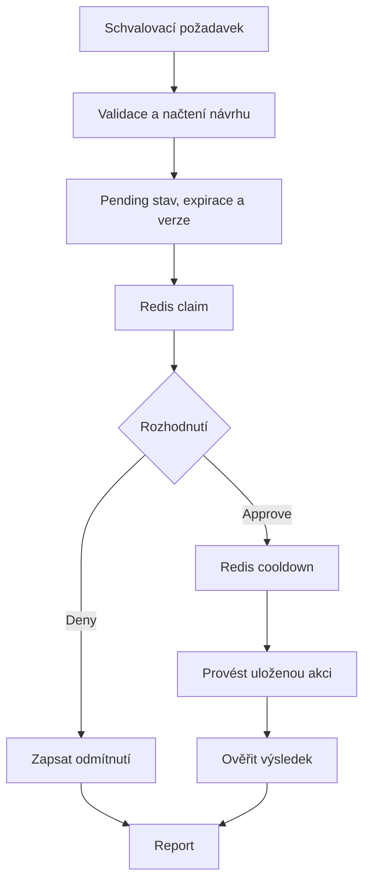

# Architektura a rozhodnutí

## Proč n8n

Zadání dovoluje export workflow a role zahrnuje automatizace i systémové integrace. n8n umožňuje rychle vytvořit ověřitelný prototyp, vizuálně oddělit diagnostiku od schválení a využít hotové LLM/tool nodes. JavaScript je použit jen tam, kde je třeba explicitní validace a pravidla; nikoli k ručnímu napodobování LLM odpovědí.

Model: Gemini 2.5 Flash přes OpenRouter. Jde o konfigurovatelnou volbu, ne požadavek architektury. Alternativní model musí podporovat kompatibilní tool calling.

## Komponenty

### 02 Operations agent

1. Authenticated POST webhook přijme přirozený text v `request`.
2. Validátor určí jedno povolené order ID a vytvoří run ID z n8n execution ID.
3. AI Agent vybírá nástroje na základě požadavku a průběžných odpovědí.
4. HTTP tool nodes předají LLM argumenty, ale workflow doplní důvěryhodný `run_id` a `expected_order_id`.
5. Finalizátor zvaliduje JSON a sestaví skutečné `steps` z `intermediateSteps`. Sváže pending návrh s recommended_action, skutečným nástrojem, order ID a run ID; nesoulad odmítne. Report rozlišuje doporučení, pending návrh a skutečně provedenou akci. Vyžaduje neprovedený návrh s platnou expirací, úplnými argumenty a neprázdnými poli LLM reportu; jinak vrací failed bez nabídky schválení.

Nástroje nejsou povinný pevný řetězec. Konkrétní běh pro sync problém ověřil objednávku, platbu, fulfillment, logy a připravil retry návrh; běh pro pending platbu potřeboval pouze dvě kontroly.

### 01 Mock systems

Zdrojem dat je vlastní testovací stav ve static data tohoto workflow. Obsahuje čtyři objednávky, návrhy, incidenty, počitadla běhů a audit událostí.

Veřejně dostupné nástroje pro LLM:

| Tool | Vstup | Výsledek |
|---|---|---|
| `get_order` | order_id | Stav objednávky |
| `get_payment` | order_id | paid / pending |
| `get_fulfillment` | order_id | Skladový stav, blokace, shipped |
| `get_sync_logs` | order_id | Historie nebo simulované HTTP 503 |
| `retry_sync` | order_id | Konkrétní návrh ke schválení; zatím žádná změna |
| `create_ticket` | description; v demo navíc order_id | Návrh incidentu ke schválení; zatím žádný ticket |

Bezpečnostní brána je součástí významu mutation tools: agent jejich zavoláním požádá o operaci, systém ji pozastaví do samostatného schválení. Skutečný efekt provede až execution část. To není tvrzení, že retry již proběhl.

Interní operace `inspect_proposal`, `execute_approved`, `get_audit` a `reset_demo` nejsou LLM nástroje. Jsou chráněné odděleným interním credentialem.

### 03 Approval and execution

Schvalovací request nemůže přepsat action ani arguments. Při retry mock napodobuje idempotentní přijetí objednávky, nastaví stav ready_to_ship a ověří fulfillment v témže mock úložišti. Nejde o nezávislé ověření vzdáleného WMS. Při ticketu ověří existenci konkrétního ticket ID v mock úložišti.

Návrh je spotřebován před side effectem. Bez nové kontroly se opakovaně neprovádí. Retry vyžaduje poslední přečtený i aktuální failed sync záznam s error kódem; logy jsou nejnovější-první a stará chyba překrytá úspěchem nestačí. Podmínka se kontroluje znovu před provedením. Redis guard vyžaduje jediný přesný klíč a kladné safe integer číslo bez pole error. Redis slouží jako atomický gate, ne jako transakční náhrada celého mock úložiště.

### 00 Admin demo reset

Samostatný endpoint s interním credentialem odstraní vlastní demo cooldowny a resetuje pouze vlastní mock data. Není připojen k AI Agent node. Používá se při přípravě nové demonstrace, ne jako business funkce.

## Chyby a observabilita

- Validátor řeší prázdné, příliš dlouhé a nejednoznačné vstupy.
- Tool error zůstává v historii skutečného volání; model nesmí neověřená data prezentovat jako získaná.
- Neplatný JSON/schema od LLM vytvoří failed report.
- MaxIterations, tool budget a execution timeout omezují délku běhu.
- V executions lze dohledat model, tool arguments, observations, validaci a schvalovací větev.
- `decision` v reportu je stručný log zvolené operace, nikoli zveřejňování skrytého interního uvažování modelu.

## Produkční rozdíly

DB místo static data; atomická vazba proposal/claim/action ledger; konkrétní uživatelská identita a RBAC; HTTPS; externí audit a monitoring; ošetření nejasných timeoutů skutečných API; rate limits a dlouhodobé retention policy. Pro case study jsou tyto hranice záměrně popsány, nikoli maskovány jako hotové funkce.

## Ověření finální verze

73 regresních kontrol spouští kód z finálních exportů a offline prochází také schvalovací graf. Výsledek obsahuje hashe kontrolovaných exportů. Síť, credentials, skutečné Redis TTL, souběžnost a LLM vyžadují živý běh; uložené živé příklady pocházejí z v2.1. Podrobnosti jsou v `TEST_RESULTS.md`.
